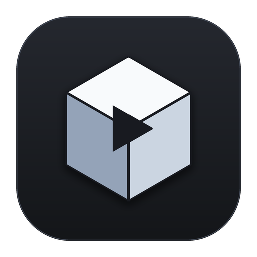

# Universal Media Downloader v3.5.1

<p align="center">
  
</p>

<p align="center">
  <b>Universal Media Downloader</b> — десктопное приложение для загрузки видео, аудио, сериалов и прямых трансляций. Интерфейс выполнен в строгом стиле Windows Fluent Design.
</p>

<p align="center">
  <a href="#новое-в-версии-351">Новое в v3.5.1</a> •
  <a href="#ключевые-возможности-и-улучшения">Возможности и улучшения</a> •
  <a href="#поддерживаемые-платформы">Платформы</a> •
  <a href="#удаленное-управление-через-telegram">Telegram-бот</a> •
  <a href="#работа-с-онлайн-кинотеатрами">Онлайн-кинотеатры</a> •
  <a href="#установка-и-дистрибутивы">Установка</a> •
  <a href="#сборка-из-исходного-кода">Сборка из кода</a>
</p>

---

## Новое в версии 3.5.1

- **Обновлённый единый интерфейс вкладок «Загрузки», «История» и «Настройки»**:
  - **Настройки (`SettingsTab`)**: все 7 разделов переведены в компактные сворачиваемые карточки-аккордеоны (`AccordionSectionCard`) с кнопками «Развернуть все / Свернуть все», живыми статус-сводками в заголовках и сохранением состояния в `QSettings`.
  - **История (`HistoryTab`)**: переход с таблицы на карточный список (`HistoryItemWidget`) в стиле очереди загрузок с верхней панелью фильтров (статус, платформа, поиск), быстрыми действиями и аккуратным боковым индикатором выбора без артефактов рамки.
  - **Загрузки и пустые состояния**: унифицированная панель фильтров очереди, общая карточка `EmptyStateCard` для пустых списков и нулевых результатов поиска, а также полный паритет тёмной/светлой темы и локализации (RU / EN / UK).

## Новое в версии 3.5.0

- **Умный сниффер потоков 2.0 (Universal Stream Sniffer)**:
  - Перехват безымянных HLS/DASH-потоков по сигнатуре (`#EXTM3U` / `<MPD`), защита от захвата коротких прероллов и трейлеров, блокировка рекламных попапов и поддержка RU/UA/EN кнопок запуска плеера (`Смотреть` / `Дивитись` / `Watch`).
  - Автоматический разбор вариантов разрешений (`1080p`, `720p`, …) из `master.m3u8`, сохранение cookies и токен-заголовков (`Authorization`, `X-Token` и др.), кэш стратегий по доменам и детекция коммерческого DRM (`Widevine`/`PlayReady`/`FairPlay`) с точной диагностикой причин ошибок.
  - Интерактивный режим перехвата (`🌐` на карточке с ошибкой): открывает видимый браузер для прохождения капчи/авторизации и ручного запуска видео.
- **Управление файлами и медиавозможности**:
  - Во вкладке **«Файлы»** добавлены мгновенный поиск, фильтрация (`Все файлы / Видео / Аудио`), сортировка (`Сначала новые / Сначала крупные / По названию`) и переименование файлов; сканирование переведено на быстрый `os.scandir()`, убраны лишние запуски FFmpeg для аудио и исправлено открытие вкладки с первого клика.
  - Поддержка глав YouTube (**«Вшить главы»** и **«Разбить видео по главам»** в подпапку) и опция архива загрузок (`download_archive`) против повторного скачивания плейлистов.
  - Диалог выбора для ссылок **YouTube Mix / Radio** (`list=RD*` / `start_radio=1`): только текущее видео или список треков микса.
- **Надёжность, скорость и резервное копирование**:
  - Проверка контрольной суммы **SHA-256** при автообновлении приложения.
  - Экспорт и импорт резервной копии настроек, истории и архива загрузок в ZIP.
  - Пул HTTP-соединений в многопоточном загрузчике, ускоренный старт окна, исправлена светлая тема в диалогах/оверлее и кнопка «Очистить» в нижней панели.

---

## Ключевые возможности и улучшения

### 1. Загрузка и управление качеством
- **Быстрый выбор разрешения в карточке**: Переключение качества видео (от 360p до 4K) и режима извлечения звука (MP3) прямо из выпадающего меню на карточке задачи, с предварительным расчетом веса каждого варианта.
- **Интеллектуальная оценка размера**: Для онлайн-кинотеатров и HLS-манифестов приложение заранее рассчитывает реальный размер серии на основе битрейта и длительности.
- **Приоритет видеокодеков**: Возможность выбора предпочтительного кодека в настройках:
  - **H.264 (AVC)** — максимальная совместимость со старыми телевизорами, медиаплеерами и смартфонами;
  - **AV1 / VP9** — улучшенное сжатие и экономия дискового пространства при высоком качестве.
- **Встроенная обрезка по времени**: Точная нарезка фрагмента видео без необходимости полной загрузки всего ролика.

### 2. Поддержка онлайн-кинотеатров и сериалов
- **Пакетная загрузка сезонов**: Встроенные диалоговые окна для AnimeGO, KinoPub, HDRezka и vi3000.top (Lampa) с выбором озвучки, сезона и нужных серий.
- **Оригинальные логотипы платформ**: Полноцветные векторные и адаптированные логотипы сервисов для комфортной визуальной навигации.

### 3. Удаленное управление через Telegram-бота
- **Интерактивные кнопки в чате**: При отправке ссылки на сериал бот выводит кнопки для выбора студии перевода, качества и списка серий прямо в мессенджере.
- **Обратная отправка файлов**: Готовые аудио- и видеофайлы размером до 50 МБ автоматически пересылаются пользователю в ответном сообщении.

### 4. Встроенные медиаинструменты
- **Аудиоконвертер**: Быстрое преобразование любых скачанных или локальных файлов в форматы MP3, AAC, FLAC, WAV, OGG с битрейтом до 320 kbps.
- **Инспектор метаданных (Media Info)**: Просмотр технической информации о файле (разрешение, частота кадров, кодеки видео и звука, количество каналов) через встроенный модуль FFprobe.
- **Менеджер файлов**: Вкладка «Скачанные файлы» с фильтрацией по категориям (видео, аудио, архивы), мгновенным распознаванием качества и контекстным меню действий.

### 5. Автоматизация и интерфейс
- **Планировщик загрузок**: Запуск задач по расписанию или по таймеру с возможностью автоматического выключения ПК по окончании всех загрузок.
- **Drag & Drop**: Перетаскивание ссылок и текстовых списков (`.txt`) в окно программы с визуальной индикацией зоны сброса.
- **Строгий дизайн**: Полноценная поддержка светлой и темной тем оформления, аккуратные шрифты и отсутствие лишних визуальных элементов.

---

## Поддерживаемые платформы

- **Видеохостинги и соцсети:** YouTube, RuTube, VK Видео, TikTok, Instagram, Pinterest, X (Twitter), Facebook, Twitch (VOD и прямые трансляции), Kick.
- **Кинотеатры и аниме:** AnimeGO, KinoPub, HDRezka, vi3000.top (Lampa), плееры Kodik, Aniboom, Alloha, Voidboost.
- **Универсальная поддержка:** Любые прямые ссылки на видеофайлы (`.mp4`, `.mkv`, `.webm`), а также потоковые трансляции `.m3u8` и `.mpd`.

---

## Удаленное управление через Telegram

1. Создайте бота через официального [@BotFather](https://t.me/BotFather) и скопируйте полученный токен.
2. Откройте вкладку **«Telegram Бот»** в программе, вставьте токен и нажмите **«Запустить бота»**.
3. Отправьте боту команду `/start` с телефона.
4. Отправляйте ссылки на видео или сериалы:
   - Для одиночных видео загрузка начнется автоматически.
   - Для сериалов бот предложит выбрать озвучку и серии с помощью интерактивных кнопок.
   - Файлы размером до 50 МБ бот отправит обратно в чат.

---

## Работа с онлайн-кинотеатрами

### AnimeGO и Kodik
При вставке ссылки на страницу аниме программа автоматически опрашивает доступные плееры, формирует список серий с указанием озвучек и позволяет выбрать серию или скачать весь сезон целиком.

### KinoPub и HDRezka
Программа использует безопасный встроенный модуль для прохождения защиты сайта, считывает доступные переводы и сезоны, после чего открывает окно выбора серий.

### vi3000.top (Lampa)
При вставке ссылки открывается вспомогательное окно каталога. Достаточно запустить воспроизведение нужной серии — поток будет автоматически перехвачен программой, после чего окно закроется, а серия отправится в очередь загрузок.

---

## Установка и дистрибутивы

Готовые сборки для Windows доступны в папке `output/` и на странице релизов:

1. **Инсталлятор (`Universal_Media_Downloader_v3.5.1_Setup.exe`)**:
   - Автоматическая установка программы на компьютер.
   - Создание ярлыков в меню «Пуск» и на рабочем столе.
   - Корректная регистрация в системе и встроенный деинсталлятор.

2. **Портативная версия (`Windows_UMD_v3.5.1_Portable.zip`)**:
   - Не требует установки и прав администратора.
   - Распаковывается в любую папку или на съемный диск.
   - Настройки, история и сессии сохраняются локально в каталоге программы (`data/`).

---

## Сборка из исходного кода

### Требования
- **ОС:** Windows 10 / 11 (64-bit)
- **Python:** 3.11 или новее
- **FFmpeg:** Встроен в проект (папка `assets/ffmpeg/bin/`), дополнительная установка не требуется.
- **Deno:** Рекомендуется для работы с YouTube-плеером (`irm https://deno.land/install.ps1 | iex`).

### Порядок запуска

1. **Клонирование репозитория:**
   ```powershell
   git clone https://github.com/dimalinau-lab/universal-media-downloader-2.git
   cd universal-media-downloader-2
   ```

2. **Создание и активация виртуального окружения:**
   ```powershell
   python -m venv .venv
   .venv\Scripts\Activate.ps1
   ```

3. **Установка зависимостей:**
   ```powershell
   pip install -r requirements.txt
   ```

4. **Запуск приложения:**
   ```powershell
   python main.py
   ```

5. **Сборка исполняемого файла (PyInstaller):**
   ```powershell
   pyinstaller --distpath output Windows3.3.UMD.spec
   ```

6. **Сборка инсталлятора (Inno Setup):**
   ```powershell
   "D:\Inno Setup 6\ISCC.exe" installer.iss
   ```

---

## Структура проекта

```text
universal-media-downloader/
├── app/                        # Основной исходный код
│   ├── extractors/             # Модули парсинга сервисов (AnimeGO, Pinterest)
│   ├── main_window.py          # Главное окно приложения (Fluent UI)
│   ├── download_manager.py     # Диспетчер очереди и задач
│   ├── download_task.py        # Модель задачи скачивания
│   ├── download_item_widget.py # Виджет элемента очереди
│   ├── universal_sniffer.py    # Каскадный универсальный сниффер потоков
│   ├── threads.py              # Потоки анализа, yt-dlp и прямых загрузок
│   ├── files_tab.py            # Менеджер скачанных файлов
│   ├── history_tab.py          # Журнал истории
│   ├── telegram_bot.py         # Бэкенд Telegram-бота 2.0
│   ├── telegram_tab.py         # Настройки и статус Telegram
│   ├── settings_tab.py         # Настройки форматов, папок и кодеков
│   ├── browser_cookies.py      # Безопасный импорт сессий браузера
│   ├── theme_manager.py        # Управление темами (Dark/Light)
│   └── translation.py          # Модуль локализации (RU/EN/UK)
├── assets/                     # Графические ресурсы, иконки, логотипы, переводы
│   ├── ffmpeg/bin/             # Встроенные бинарные файлы FFmpeg и FFprobe
│   └── logos/                  # Логотипы поддерживаемых видеохостингов
├── installer.iss               # Конфигурация Inno Setup для сборщика инсталлятора
├── Windows3.3.UMD.spec         # Конфигурация сборщика PyInstaller
├── main.py                     # Точка входа программы
└── requirements.txt            # Список зависимостей Python
```

---

## Лицензия

Проект распространяется под условиями открытой лицензии [MIT](file:///d:/pton/PythonProject9/LICENSE).
